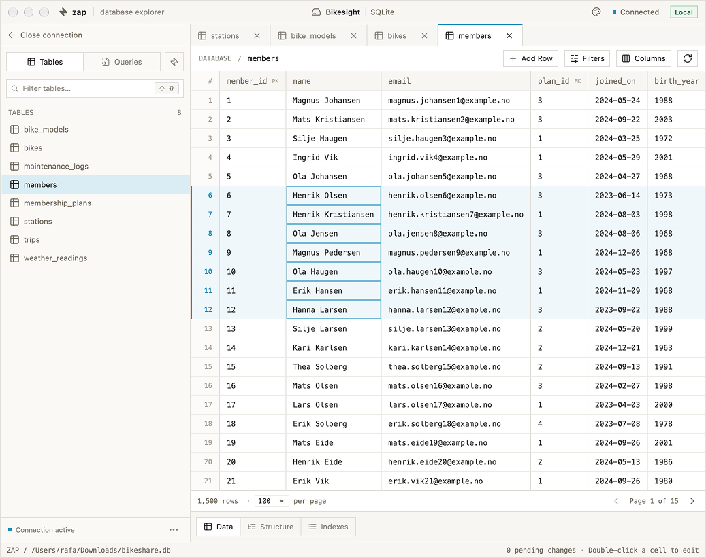

<p align="center">
  
</p>

<h1 align="center">Zap</h1>

<p align="center">
  <a href="https://github.com/mnml-tools/zap/actions/workflows/rust.yml"></a>
  <a href="https://github.com/mnml-tools/zap/actions/workflows/desktop.yml"></a>
</p>

<p align="center">
  A minimal desktop database explorer for PostgreSQL, MySQL, and SQLite.
</p>

Zap lets you browse tables, edit data, and save SQL queries in one workspace. It’s built with Tauri, React, TypeScript, and Rust.

<picture>
  <source media="(prefers-color-scheme: dark)" srcset="docs/zap-screenshot-dark.png">
  <source media="(prefers-color-scheme: light)" srcset="docs/zap-screenshot-light.png">
  
</picture>

View screenshots in [light mode](docs/zap-screenshot-light.png) or [dark mode](docs/zap-screenshot-dark.png).

> [!IMPORTANT]
> **A note on AI use:** I’m against the blind use of AI and generally oppose generating large portions of code with it. That said, I used AI-generated code to build Zap: I wanted a custom tool for myself and chose to experiment with how quickly AI could help me build it. This was also a chance to study these tools from a user’s perspective, how they work, how to communicate with them, and how to use them to implement features. I want to understand this technology and keep up with it, even if I don’t use it every day.

## What you can do

- **Connect** to PostgreSQL or MySQL directly or over SSH, or pick an existing SQLite file. Saved passwords stay in your operating system’s credential store.
- **Explore** tables in tabs with Data, Structure, and Indexes views. Views and materialized views are listed separately and open read-only. Search the sidebar, filter and sort rows, and choose which columns to show.
- **Follow relations** from any foreign-key cell: click its ↗ icon, or Ctrl+click (⌘-click on macOS), to see the referenced row in a side panel. Follow further references from there, or open the row in its own filtered tab.
- **Edit** cells and stage changes before saving. In Structure, you can rename tables and add fields. Available edits depend on the database driver and permissions.
- **Run SQL** with a syntax-highlighted editor that suggests tables, columns, and keywords as you type. Save queries per connection and revisit them in their own tabs.
- **Import and export SQL** from the sidebar’s **⋯** menu. Export one table or a selection, with rows or structure only.
- **Make it yours** with Light or Dark mode and five accent colours. Zap remembers your appearance settings, sidebar width, and window size.

## Run locally

Install Node.js 24, Rust, and the [Tauri prerequisites](https://v2.tauri.app/start/prerequisites/) for your operating system. From the project root, run:

```sh
npm ci
npm run tauri dev
```

Use `npm run dev` to preview the interface in a browser. Database operations use the desktop runtime.

## Build desktop packages

### macOS

On a Mac with the Xcode command line tools installed, run:

```sh
npm ci
npm run build:mac
```

This regenerates the app icons from [AppIcon.svg](src/assets/AppIcon.svg) and produces:

- **App** at `src-tauri/target/release/bundle/macos/Zap.app`
- **DMG** in `src-tauri/target/release/bundle/dmg/`

For public distribution, see [Tauri’s macOS signing and notarization guide](https://v2.tauri.app/distribute/sign/macos/).

### Linux AppImage

Run the build on Linux after installing the [Linux build prerequisites](https://v2.tauri.app/start/prerequisites/#linux). From macOS, use a Linux VM or CI runner. Choose an x86_64 Linux environment for an Intel/AMD AppImage or an ARM64 Linux environment for an ARM64 AppImage.

```sh
npm ci
npm run icons
npm run tauri build -- --bundles appimage
```

Find the package in `src-tauri/target/release/bundle/appimage/` in your Linux checkout. See [Tauri’s AppImage guide](https://v2.tauri.app/distribute/appimage/) for distribution details.

## Automated desktop builds

The **Desktop builds** GitHub Actions workflow runs on every push to `main`,
on version tags matching `v[0-9]*`, and through **Run workflow** in the Actions tab.
It runs the frontend and Rust tests, then builds a Linux x86_64 AppImage and a
universal macOS `.app` for Apple Silicon and Intel Macs.

Download the packages from the workflow run's **Artifacts** section. Artifact
names include the commit SHA and downloads are retained for 14 days. Extract
`Zap-macos-universal.app.zip` to get `Zap.app`.

To publish a GitHub Release, update the versions in `package.json`,
`package-lock.json`, `src-tauri/Cargo.toml`, `src-tauri/Cargo.lock`, and
`src-tauri/tauri.conf.json`, commit the changes, then push a matching tag:

```sh
git tag v0.4.0
git push origin v0.4.0
```

The release is published after both platform builds pass, with both packages
attached. The workflow uses GitHub's built-in token for publishing. Version-tag builds also require the updater signing secrets described below.
macOS builds are not Developer ID signed or notarized, so downloaded apps may
require approval in macOS security settings. For public distribution, configure
[macOS signing and notarization](https://v2.tauri.app/distribute/sign/macos/).

## Automatic updates

Published version-tag builds check GitHub Releases once at startup (with a 15-second timeout).
When a newer version is available, Zap offers **Install and restart** or **Later**.
If SQL, table data, or structure edits are unsaved, a second prompt lets you cancel
and save your work or explicitly discard changes. Updating is blocked while query
execution, saves, imports, exports, or table actions are running. A modal blocks
editing during download and installation. Failed checks do not interrupt startup;
failed installations show an error and allow retrying.

### Configure GitHub signing secrets

Generate an updater signing key pair on your own machine:

```sh
npm run tauri signer generate -- -w "$HOME/.tauri/zap.key"
```

In the repository's **Settings → Secrets and variables → Actions**, add:

| Secret | Value |
| --- | --- |
| `TAURI_SIGNING_PRIVATE_KEY` | Full contents of `zap.key`, not its path. |
| `TAURI_SIGNING_PRIVATE_KEY_PASSWORD` | The password chosen when generating the key; omit if unencrypted. |
| `TAURI_UPDATER_PUBLIC_KEY` | Full contents of `zap.key.pub`. This is public information, stored as a secret for build configuration convenience. |

Back up the private key and its password securely. Keep using the same key pair for
future versions so existing installations can verify updates. Never commit the private key.
Updater signatures are separate from Apple Developer ID signing and notarization.

Tag builds embed the public key, generate signed updater artifacts, and publish
`latest.json`, the macOS `.app.tar.gz` and Linux AppImage, and their `.sig` files.
The manifest maps both Intel and Apple Silicon Macs to the universal macOS archive.
The release tag must match the app version, e.g. `v0.4.0` for `0.4.0`.
The GitHub repository and release assets must be publicly downloadable.

Ordinary branch and local builds do not require signing secrets; their updater key
is empty, so they cannot check for updates until configured. To build locally with
updates, set `plugins.updater.pubkey` to your public key and enable
`bundle.createUpdaterArtifacts` in a local Tauri config override, then provide the
`TAURI_SIGNING_PRIVATE_KEY` and optional password environment variables when building.
Development mode skips startup checks.

Existing installations need one manual upgrade to the first release containing
this updater. Test the full flow using two signed versions before relying on it
for distribution: install the older version, publish the newer version, reopen
Zap, verify cancel preserves dirty work, then install and restart.

## Development checks

```sh
npm run build
npm test
npm run format:check
cargo test --manifest-path src-tauri/Cargo.toml
```

For UI checks with sample data, run the Vite server and open `/tests/editor.html`. The fixture uses an in-memory mock and can simulate a save failure. See the [frontend architecture guide](docs/architecture.md) for the code layout.

## License

Zap is source-available under the custom [Zap Noncommercial Share-Alike
No-AI-Cloning License 1.0](LICENSE).

- Use, study, modify, and fork Zap for noncommercial purposes.
- Share copies and modified versions under the exact same license, with notices
  preserved and corresponding source provided to recipients.
- Commercial use, commercial forks, sales, paid hosting, and use in a
  profit-seeking business's operations are prohibited, even under the same license.
- Using AI to clone or substantially reproduce Zap from its protected materials
  is prohibited, including for noncommercial clones. AI assistance with
  understanding, testing, debugging, and maintaining a permitted fork is allowed.

The full license controls. Third-party dependencies retain their own licenses.
These restrictions make Zap source-available rather than open-source under the
[Open Source Definition](https://opensource.org/osd). The AI restriction does not
claim ownership of general ideas or independently created software.

## macOS Keychain prompts

When macOS asks Zap for access to a saved password, use your login Keychain password, usually your Mac login password. **Allow** grants one access and **Always Allow** remembers permission for that app identity. Zap caches authorized credentials in memory until it exits. Development rebuilds can change the app identity and prompt again. See [Apple’s Keychain guide](https://support.apple.com/en-gb/guide/mac-help/kychn002/26/mac/26).
