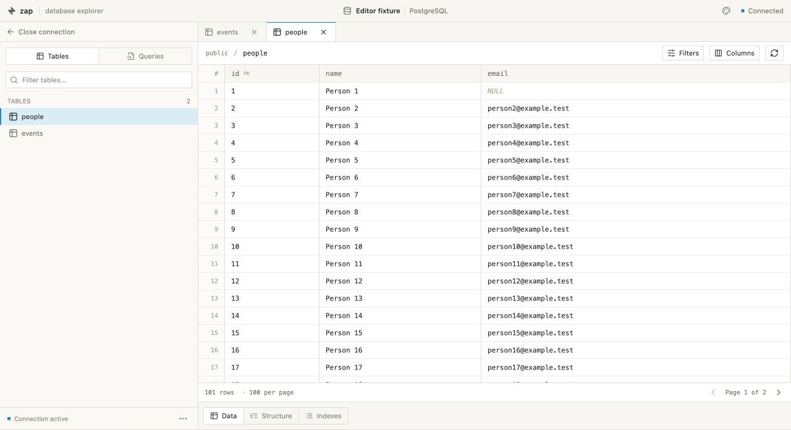

<p align="center">
  
</p>

<h1 align="center">Zap</h1>

<p align="center">
  <a href="https://github.com/rafmst/zap/actions/workflows/rust.yml"></a>
  <a href="https://github.com/rafmst/zap/actions/workflows/desktop.yml"></a>
</p>

<p align="center">
  A minimal desktop database explorer for PostgreSQL, MySQL, and SQLite.
</p>

Zap lets you browse tables, edit data, and save SQL queries in one workspace. It’s built with Tauri, React, TypeScript, and Rust.



## What you can do

- **Connect** to PostgreSQL or MySQL directly or over SSH, or pick an existing SQLite file. Saved passwords stay in your operating system’s credential store.
- **Explore** tables in tabs with Data, Structure, and Indexes views. Search the sidebar, filter and sort rows, and choose which columns to show.
- **Edit** cells and stage changes before saving. In Structure, you can rename tables and add fields. Available edits depend on the database driver and permissions.
- **Run SQL** with a syntax-highlighted editor. Save queries per connection and revisit them in their own tabs.
- **Import and export SQL** from the sidebar’s **⋯** menu. Export one table or a selection, with rows or structure only.
- **Make it yours** with Light or Dark mode and five accent colours. Zap remembers your appearance settings, sidebar width, and window size.

## Run locally

Install Node.js 24, Rust, and the [Tauri prerequisites](https://v2.tauri.app/start/prerequisites/) for your operating system. From the project root, run:

```sh
npm ci
npm run tauri dev
```

Use `npm run dev` to preview the interface in a browser. Database operations use the desktop runtime.

## Build desktop packages

### macOS

On a Mac with the Xcode command line tools installed, run:

```sh
npm ci
npm run build:mac
```

This regenerates the app icons from [AppIcon.svg](src/assets/AppIcon.svg) and produces:

- **App** at `src-tauri/target/release/bundle/macos/Zap.app`
- **DMG** in `src-tauri/target/release/bundle/dmg/`

For public distribution, see [Tauri’s macOS signing and notarization guide](https://v2.tauri.app/distribute/sign/macos/).

### Linux AppImage

Run the build on Linux after installing the [Linux build prerequisites](https://v2.tauri.app/start/prerequisites/#linux). From macOS, use a Linux VM or CI runner. Choose an x86_64 Linux environment for an Intel/AMD AppImage or an ARM64 Linux environment for an ARM64 AppImage.

```sh
npm ci
npm run icons
npm run tauri build -- --bundles appimage
```

Find the package in `src-tauri/target/release/bundle/appimage/` in your Linux checkout. See [Tauri’s AppImage guide](https://v2.tauri.app/distribute/appimage/) for distribution details.

## Automated desktop builds

The **Desktop builds** GitHub Actions workflow runs on every push to `main`,
on version tags matching `v[0-9]*`, and through **Run workflow** in the Actions tab.
It runs the frontend and Rust tests, then builds a Linux x86_64 AppImage and a
universal macOS `.app` for Apple Silicon and Intel Macs.

Download the packages from the workflow run's **Artifacts** section. Artifact
names include the commit SHA and downloads are retained for 14 days. Extract
`Zap-macos-universal.app.zip` to get `Zap.app`.

To publish a GitHub Release, update the versions in `package.json`,
`package-lock.json`, `src-tauri/Cargo.toml`, `src-tauri/Cargo.lock`, and
`src-tauri/tauri.conf.json`, commit the changes, then push a matching tag:

```sh
git tag v0.3.0
git push origin v0.3.0
```

The release is published after both platform builds pass, with both packages
attached. The workflow uses GitHub's built-in token; no extra secrets are needed.
macOS builds are not Developer ID signed or notarized, so downloaded apps may
require approval in macOS security settings. For public distribution, configure
[macOS signing and notarization](https://v2.tauri.app/distribute/sign/macos/).

## Development checks

```sh
npm run build
npm test
npm run format:check
cargo test --manifest-path src-tauri/Cargo.toml
```

For UI checks with sample data, run the Vite server and open `/tests/editor.html`. The fixture uses an in-memory mock and can simulate a save failure. See the [frontend architecture guide](docs/architecture.md) for the code layout.

## macOS Keychain prompts

When macOS asks Zap for access to a saved password, use your login Keychain password, usually your Mac login password. **Allow** grants one access and **Always Allow** remembers permission for that app identity. Zap caches authorized credentials in memory until it exits. Development rebuilds can change the app identity and prompt again. See [Apple’s Keychain guide](https://support.apple.com/en-gb/guide/mac-help/kychn002/26/mac/26).
